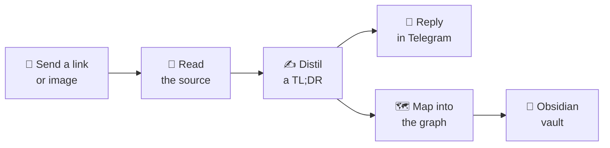
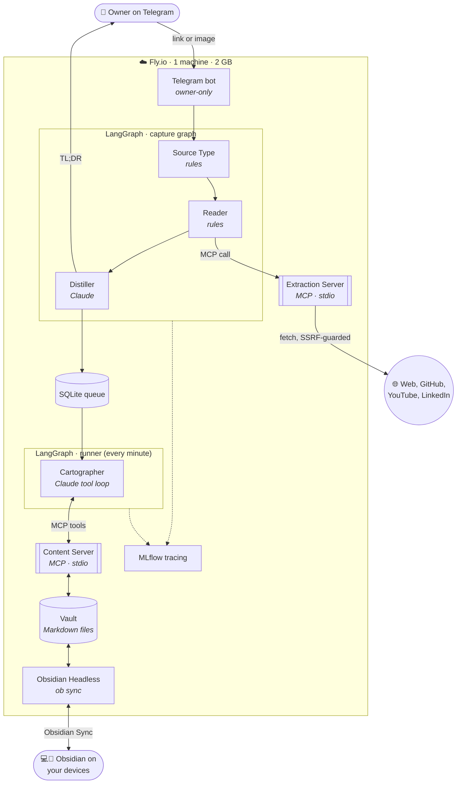
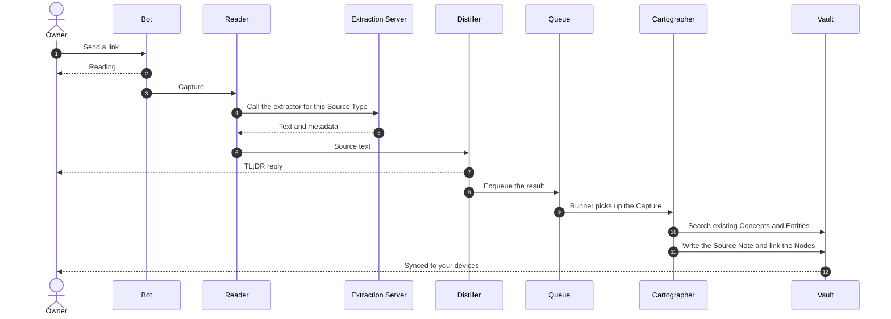
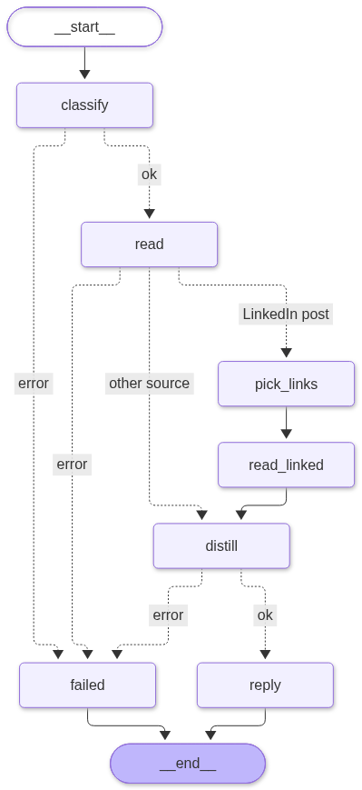
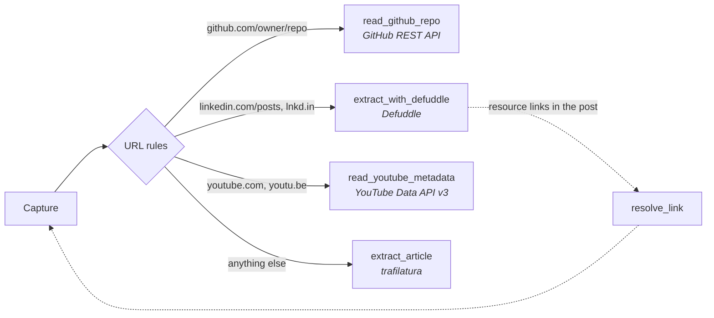

<div align="center">


**Turn the links you save into knowledge that compounds.**

A Telegram bot that reads what you send it, replies with a TL;DR, and weaves every source into an Obsidian knowledge graph.


</div>

---

## The problem

> I save a steady stream of articles, repos, LinkedIn posts and videos to Telegram *Saved Messages*, meaning to come back to them. I rarely do. When I do, the notes become isolated pages that never connect.

| Today | With Synthora |
|---|---|
| Links pile up unread | A **TL;DR** arrives within ~1 minute |
| Notes are orphaned pages | Each source links into shared **Concepts** and **Entities** |
| Understanding stays flat | Concept summaries are **rewritten as evidence accumulates** |
| Data locked in an app | Plain Markdown in an **Obsidian vault** you own |

## How it works



## Demo

### 💬 Send a link, get a TL;DR

The bot reads the link and replies with the key idea in under a minute.

https://github.com/user-attachments/assets/1dfc852c-9467-4e33-b89d-73ecfe2eac56

### 🧠 It connects itself to your knowledge graph

Each link joins the existing topics it relates to, or starts new ones, so related ideas cluster together in Obsidian.

https://github.com/user-attachments/assets/5369af68-4468-4009-8085-2d99ee9f2a43

## Architecture

Everything runs on **one always-on Fly.io machine**. The vault lives on the server as plain files and syncs to your devices through **Obsidian Headless** (`ob sync`), so your laptop can stay offline ([ADR 0008](docs/adr/0008-server-side-vault-with-obsidian-headless.md)).



### Capture lifecycle



### The capture graph

The LangGraph graph behind steps 3–8, drawn straight from the code with [scripts/draw_graphs.py](scripts/draw_graphs.py). LinkedIn posts take an extra branch to pick and read the resource links inside them. Any error routes to `failed`, which tells you what went wrong.

<p align="center">
  
</p>

### Reading: one source type, one extractor

The Reader is **rule-based, not an agent**. URL rules decide the Source Type, and each type maps to exactly one MCP tool.



## Tech stack

| | Layer | Choice |
|:-:|---|---|
|  | Language | Python 3.13 |
|  | Orchestration | LangGraph |
|  | LLMs | Claude via `langchain-anthropic` |
|  | Tools | Two MCP servers: **Extraction** and **Content** |
|  | Interface | `python-telegram-bot` |
|  | Extraction | trafilatura · Defuddle (Node.js) |
|   | Source APIs | GitHub REST · YouTube Data API v3 |
|  | Queue | SQLite on a Fly volume |
|  | Knowledge base | Obsidian vault · Obsidian Headless sync |
|  | Observability | MLflow tracing |
|   | Hosting | Fly.io (Docker, 1 × shared-cpu, 2 GB) |
|  | Packaging | uv |

## Getting started

```bash
# 1. Install dependencies (Python 3.13, uv, Node.js for Defuddle)
uv sync

# 2. Add secrets to .env
TELEGRAM_TOKEN=...
OWNER_TELEGRAM_ID=...
LLM_API_KEY=...
GOOGLE_API_KEY=...      # YouTube Data API v3
GITHUB_TOKEN=...        # optional, raises the rate limit

# 3. Run
uv run synthora-bot      # Telegram bot + capture graph
uv run synthora-runner   # turn queued Captures into vault notes
```

Settings live in [configs/config.yaml](configs/config.yaml). Any value can be overridden with an environment variable, e.g. `LLM__MODEL=...`.

```bash
uv run pytest              # unit tests
uv run pytest -m live      # hits the real internet
uv run pytest -m obsidian  # needs Obsidian running with the test vault
```

### Deploying to Fly.io

[start.sh](start.sh) launches MLflow, `ob sync`, the runner loop and the bot inside one container. The vault, the SQLite queue and the `ob` login all live on the Fly volume, so they survive deploys.

```bash
fly secrets set TELEGRAM_TOKEN=... LLM_API_KEY=...   # secrets never go in fly.toml
fly deploy
fly ssh console                                       # once: log in to Obsidian Headless
```

## Project layout

```text
src/synthora/
├── bot/            Telegram bot
├── capture/        capture graph: Reader, Distiller, link picker
├── extraction/     Extraction MCP server + extractors + SSRF guard
├── runner/         turns queued Captures into notes
├── cartographer/   graph-building agent
├── content/        Content MCP server (vault tools)
├── obsidian/       vault access (CLI + file backends)
├── api/            pull API (fallback for a laptop runner)
├── domain/         core types
└── prompts/        system prompts
```

## Security

| Risk | Guardrail |
|---|---|
| **SSRF** (tricking the server into fetching an internal URL) | All fetching happens in the Extraction Server through one HTTP client that allows only `http`/`https` and refuses private, loopback and link-local addresses, including after redirects |
| **Prompt injection** from fetched pages | Source text is treated as data, never instructions. Safety rules live in tool code, not prompts |
| **Strangers using the bot** | The bot only responds to the owner's Telegram user ID |
| **Overwriting your notes** | Write tools never overwrite, Evidence is append-only, and a guard blocks any change to **My Notes**. A note edited on any device in the last 2 minutes is left alone and retried later |
| **Undoing a bad write** | Obsidian Sync's version history and Fly's daily volume snapshots |
| **Exposed internal services** | MLflow stays inside the container. The only public port is the token-protected pull API |
| **Leaked keys** | Secrets are kept in `.env` / Fly secrets and sent in headers, never in URLs or logs |

## Documentation

- [Product requirements](docs/PRD.md)
- [Glossary](CONTEXT.md)
- [Architecture decision records](docs/adr/). Key decisions:
  - [0004 · Rule-based Reader](docs/adr/0004-rule-based-reader.md)
  - [0006 · Content Server over stdio](docs/adr/0006-content-server-on-laptop-over-stdio.md)
  - [0007 · Host on Fly.io](docs/adr/0007-host-the-server-on-fly-io.md)
  - [0008 · Server-side vault with Obsidian Headless](docs/adr/0008-server-side-vault-with-obsidian-headless.md)
